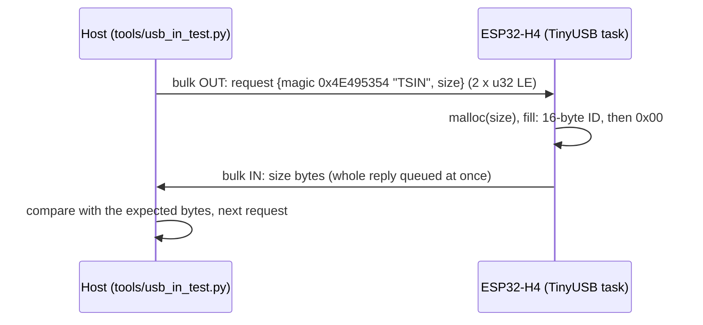

| Supported Targets | ESP32-H4 |
| ----------------- | -------- |

# ESP32-H4 USB CDC: IN (device to host) data loss

This repository reproduces a USB CDC-ACM problem on the **ESP32-H4**: data sent by the device to the host
(bulk IN) is lost or the IN pipe stalls, although the device queues every byte correctly. The firmware is the
ESP-IDF `peripherals/usb/device/tusb_serial_device` example with the smallest change needed for a repeatable IN test,
plus a host script that checks every reply byte by byte.

The same application code (fixed-size replies, zero padded) works on an ESP32-S3 with esp_tinyusb 1.x.

## Summary of the findings

1. **Head of the reply lost (host controller reports babble).** USBPcap shows that the device sends every reply
   complete and byte-exact, but the host controller completes the first bulk IN URB(s) of a reply with
   `USBD_STATUS_BABBLE_DETECTED (0xC0000012)`. usbser.sys drops the data of those URBs, so the application gets only
   the tail. The loss grows with the reply length: about 10 % at 128 bytes, 100 % at 8192 bytes (DMA mode, table
   below). Replies made of long runs of `0x00` are affected most; in earlier experiments with a modified firmware,
   pseudo-random replies of the same length were received 100 % intact.
2. **Slave mode (the example default): the IN pipe stalls.** After a few hundred replies the host gets no more IN
   data; in an earlier run with a modified firmware the device then panicked with an interrupt watchdog timeout,
   CPU1 looping in `dwc2_int_handler_wrap` (interrupt storm). 16-byte replies sometimes arrive with 4 extra bytes (the first 32-bit
   word repeated).
3. **DMA mode: Load access fault on a SETUP packet.** When the host opens the port, the device sometimes crashes in
   `handle_epout_dma` (`dcd_dwc2.c:1065`) → `dcd_event_setup_received` (`dcd.h:221`): the setup packet address is taken
   from `DOEPDMA0 - 8`, and `DOEPDMA0` reads near zero. The host then reports "A device attached to the system is not
   functioning".

## Test setup

| Item | Value |
|---|---|
| Chip | ESP32-H4, chip revision v0.2 (`ESP-ROM:esp32h4-eco2-20260611`) |
| ESP-IDF | master `383dda6c` (2026-10-19), reports v6.2.0; esp32h4 needs `idf.py --preview` |
| Components | `espressif/esp_tinyusb` 2.4.0, `espressif/tinyusb` 0.21.0~2 (see `dependencies.lock`) |
| USB | internal full-speed PHY, 1 CDC-ACM port, VID:PID `303A:4001` |
| Host | Windows 11, in-box `usbser.sys`, Python 3.14 + pyserial 3.5 |
| Capture | USBPcap 1.5.4.0, Wireshark/tshark 4.6.9 |

## Changes against the upstream example

| File | Change |
|---|---|
| `main/tusb_serial_device_main.c` | The echo and its application queue are replaced by the IN test: the RX callback (TinyUSB task) reads an 8-byte request `{magic, size}`, `malloc`s `size` bytes, fills them with fixed data, queues the whole buffer with `tinyusb_cdcacm_write_queue`, starts it with `tinyusb_cdcacm_write_flush(itf, 0)` and frees the buffer. The TinyUSB task is the only CDC writer. Each reply is logged on the UART console with its CRC32. |
| `sdkconfig.defaults`, `sdkconfig` | `CONFIG_TINYUSB_CDC_TX_BUFSIZE` 2048 → 8192, so an 8 KB reply is queued at once. Everything else is the example's configuration (slave mode, 1 CDC). |
| `sdkconfig.dma.defaults` | Optional overlay: `CONFIG_TINYUSB_MODE_DMA=y`. |
| `tools/usb_in_test.py` | Host test (below). |
| `tools/usb_in_pcap.py` | USBPcap capture analysis (below). |

`pytest_usb_device_serial.py` and `sdkconfig.ci*` are the upstream CI files of the echo example; they do not apply
to this firmware.

## Test protocol



Reply data (fixed, not random): `04 C8 F4 CF 7D 5E B0 4F B6 FF C5 D6 7D 96 63 57`, then zeros up to `size`
(shorter replies are cut). This is the shape of a "read ID" reply of our product: a short ID padded with zeros.

Sizes: 16, 32, 64, 128, 256, 512, 1024, 2048, 4096, 8192 bytes, 100 replies each. A reply ends when the host gets
`size` bytes or no byte for 1 s; when no byte arrives for 30 s (or the device takes no request) the test stops and
the report is still written.

## Build and flash

In an ESP-IDF (master) environment:

```
idf.py --preview set-target esp32h4      # only if sdkconfig is not for esp32h4 already
idf.py --preview build                   # slave mode (example default) -> build/
idf.py --preview -B build_dma -DSDKCONFIG=build_dma/sdkconfig "-DSDKCONFIG_DEFAULTS=sdkconfig.defaults;sdkconfig.dma.defaults" build   # DMA mode -> build_dma/
idf.py --preview -p <UART port> flash    # or: cd build && python -m esptool --chip esp32h4 -p <UART port> write-flash @flash_args
```

On our board the automatic reset into download mode does not work: hold BOOT, press RESET, release BOOT, flash,
then press RESET to run. Connect the H4 USB pins (D-/D+) to the host; the UART console stays on the USB-UART bridge.

## Run the test

```
pip install pyserial
python tools/usb_in_test.py --log-port <UART port>       # all sizes, 100 replies each
python tools/usb_in_test.py --port COM4 --sizes 2048 --count 1000
```

The CDC port is found by VID:PID `303A:4001` (or `--port`). `--log-port` reads the device UART log and checks that the
device queued every reply with the expected size and CRC32, and reports any panic or reboot. Output goes to
`test_reports/`: `usb_in_test_<time>.md` (report), `_pc.log`, `_fail.log` (hex of failed replies), `_uart.log`.

### Capture on the host (Windows)

1. Install USBPcap (reboot Windows afterwards) and Wireshark.
2. Find the root hub and device address of the board: `USBPcapCMD.exe --extcap-interface \\.\USBPcapN --extcap-config`
   lists the devices; the board is the parent of "USB Serial Device (COMx)".
3. Capture only that device while the test runs:
   `USBPcapCMD.exe -d \\.\USBPcapN --devices <address> -b 16777216 -o capture.pcap`
4. `python tools/usb_in_pcap.py capture.pcap` prints, per size, whether the host controller received every reply
   (failed URBs included), how many URBs failed and with which USBD status, and what the application could see.

## Results (this repository)

Slave mode (default configuration), `python tools/usb_in_test.py --log-port COM40`:

| Size (B) | Replies OK | Errors |
|---:|---:|---|
| 16 | 92/100 | 8 × 4 extra bytes (first 32-bit word repeated) |
| 32 | 100/100 | |
| 64 | 100/100 | |
| 128 | 3/4 | IN stalled at reply #4: no byte for 30 s, test stopped |

Device log: 304/304 replies queued with the expected size and CRC32, no warning.

DMA mode (`build_dma`), same command, run where the device did not crash on the port open:

| Size (B) | 16 | 32 | 64 | 128 | 256 | 512 | 1024 | 2048 | 4096 | 8192 |
|---|---:|---:|---:|---:|---:|---:|---:|---:|---:|---:|
| Replies OK /100 | 90 | 100 | 100 | 88 | 75 | 65 | 38 | 20 | 4 | 0 |
| Head lost | 0 | 0 | 0 | 12 | 25 | 35 | 62 | 80 | 96 | 96 |

Device log: 1000/1000 replies queued with the expected size and CRC32, no warning, no panic. All errors above 64
bytes are "head lost": the host gets the last part of the reply only.

USBPcap capture of a DMA run (`--sizes 2048 8192 --count 30`), analysed with `tools/usb_in_pcap.py`:

| Size (B) | Replies captured | Host controller got the whole reply | Replies with all URBs OK | Failed URBs | App-visible OK |
|---:|---:|---:|---:|---:|---:|
| 2048 | 28 | 28 | 5 | 60 | 5 |
| 8192 | 30 | 30 | 0 | 280 | 0 |

Bulk IN URB status: 339 × `USBD_STATUS_BABBLE_DETECTED (0xC0000012)`, 60 × success. In 52 of the 53 replies with a
failed URB, the first URB of the reply failed and the successful URBs carry exactly the expected tail. The host test
saw 5/30 and 0/30 complete replies in that run, which matches "App-visible OK". The device output on the wire is
correct; the babble condition makes the host drop it.

DMA mode crash on port open (decoded from the UART panic dump):

```
Guru Meditation Error: Core 1 panic'ed (Load access fault). MCAUSE 0x5, MTVAL near 0
  MEPC dcd_event_setup_received  dcd.h:221
  RA   handle_epout_dma          dcd_dwc2.c:1065
       handle_epin_dma           dcd_dwc2.c:1133
       handle_ep_irq             dcd_dwc2.c:1145
       dcd_int_handler           dcd_dwc2.c:1315
       dwc2_int_handler_wrap     dwc2_esp32.h:110
```

## Repository layout

```
main/tusb_serial_device_main.c   IN test firmware (example + test request handler)
sdkconfig.defaults, sdkconfig    example configuration, CDC TX FIFO 8192
sdkconfig.dma.defaults           DMA mode overlay
tools/usb_in_test.py             host IN test
tools/usb_in_pcap.py             USBPcap capture analysis
CLAUDE.md                        instructions for running the build and test with an AI coding agent
```
